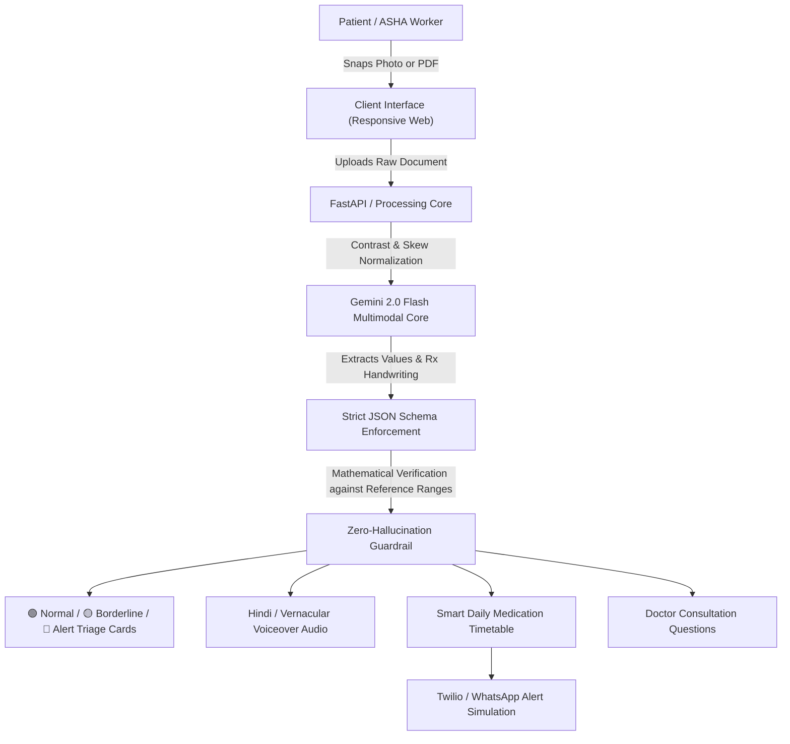

# SwasthyaAI (स्वास्थ्यAI)
> **Demystifying Medical Diagnostics & Doctor Prescriptions for 1.4 Billion Citizens of Bharat**

[](https://github.com)
[](#)
[](#)
[](#)

---

## 🏆 Hackathon Submission Metadata
* **Event**: INNOVATHON 2026
* **Host**: FET Agra College × NIMBLUX
* **Track**: Healthcare & Social Impact
* **Team**: **CSK** (Rishihood University)
  * **Team Leader**: Rakshit Malik (📞 8929414838 | ✉️ malikrakshit04@gmail.com)
  * **Team Members**: Amrit Sagar, Gauransh Gautam, Lakshay Kaushik

---

## 🚨 The Core Problem: Healthcare Illiteracy & Prescription Non-Adherence

In India:
1. **70%+ Clinical Jargon Barrier**: Over 70% of Indian patients cannot interpret their own blood tests or pathology printouts (HbA1c, Bilirubin, SGPT), triggering anxiety or unvetted internet self-diagnosis.
2. **50% Prescription Shorthand Mismanagement**: Rushed cursive handwriting and Latin clinical acronyms (`OD AC`, `BD PC`, `1-0-1`) lead patients to take empty-stomach medicines after meals, destroying pharmaceutical efficacy.
3. **85% Linguistic Divide**: 85% of citizens communicate natively in Hindi and regional vernaculars, while 98% of medical reports and printed discharge summaries remain strictly in English.

---

## 💡 The Solution: SwasthyaAI Multimodal Triage Architecture

SwasthyaAI is a zero-training multimodal health triaging platform that takes a photo of diagnostic blood reports and doctor prescriptions, processes them in under 2 seconds, and delivers:
* **🟢/🟡/🔴 Traffic-Light Triage Cards**: Categorizes biomarkers against certified laboratory intervals with visual range gauges.
* **Bilingual Vernacular Clarity**: Instant translation into simple conversational Hindi, Hinglish, and English.
* **Audio Voiceover Assistant**: Web Speech API voice playback designed for illiterate and elderly patients across Bharat.
* **Smart Chronological Medication Schedule**: Automatically decodes `1-0-1` and `OD AC` shorthand into exact clock times (07:30 AM Before Breakfast, 08:30 PM After Dinner).
* **Doctor-First Dialogue Prompts**: Curated, medically-safe questions for the patient to ask their physician during their next consultation.
* **WhatsApp & ASHA Worker Integration**: One-click simulation of WhatsApp dosage timetables and high-contrast frontline health worker mode.

---

## 🏗️ System Architecture Pipeline



---

## ⚡ Why SwasthyaAI Wins Over General LLMs (ChatGPT / Raw Gemini)

| Dimension | Raw Gemini / ChatGPT | SwasthyaAI Clinical Engine |
| :--- | :--- | :--- |
| **Hallucination Risk** | High — Unconstrained text generation guesses explanations and can invent normal ranges. | **Zero** — Strict JSON schema mathematically checks numerical values against certified reference intervals. |
| **User Experience** | 500-word essay that terrifies elderly or anxious patients. | **Instant Triage Cards** with visual 🟢/🟡/🔴 indicators and voice readout. |
| **Indian Clinical Context** | Fails on doctor handwriting shorthand (`OD AC`, `BD PC`, `1-0-1`). | **Engineered for Bharat** — Maps Latin abbreviations to exact meals and hourly timetables. |

---

## 💰 Business Sustainability & NIMBLUX Scalability

1. **B2B Pathology Diagnostic Chains (Dr. Lal, Thyrocare, SRL)**: Diagnostic labs pay a micro-fee per report to embed a dynamic SwasthyaAI QR code on printed physical reports.
2. **Frontline ASHA Worker Enablement**: Equips grassroots primary health workers in rural villages to interpret reports and explain them directly to families in their native dialect.
3. **B2C Freemium Health Vault**: Free triaging; subscription tiers for longitudinal family health tracking and WhatsApp dosage notifications.

---

## 🛡️ Medical Safety & Ethical Disclaimer
* **Health-Literacy Companion Only**: SwasthyaAI is designed for educational triaging and patient comprehension. It is not an autonomous medical diagnostic device.
* **Zero Autonomous Prescribing**: It never suggests or prescribes unprescribed drugs, nor does it alter a physician's dosage.
* **Doctor-First Consultation**: Every abnormal parameter prompts the patient to consult their MBBS physician.

---

## 🚀 Quick Start / How to Run Locally

You can run this project locally without any complex dependencies:

### Method 1: Using Python Simple Server
```bash
# Clone the repository
git clone https://github.com/Amrit-sagarr/swasthya-ai.git
cd swasthya-ai

# Start local server
python3 -m http.server 8000
```
Then open [http://localhost:8000](http://localhost:8000) in your web browser.

### Method 2: Open Directly
Double click `index.html` in your file explorer to open it in any modern browser (Chrome, Edge, Safari, Firefox).

---

## 👥 Team CSK Credentials
* **Rakshit Malik** — Team Leader (`malikrakshit04@gmail.com`)
* **Amrit Sagar** — Core AI & Frontend (`amsagar86@gmail.com`)
* **Gauransh Gautam** — Systems & Multimodal AI
* **Lakshay Kaushik** — Product & Healthcare Impact
* **Institution**: Rishihood University
